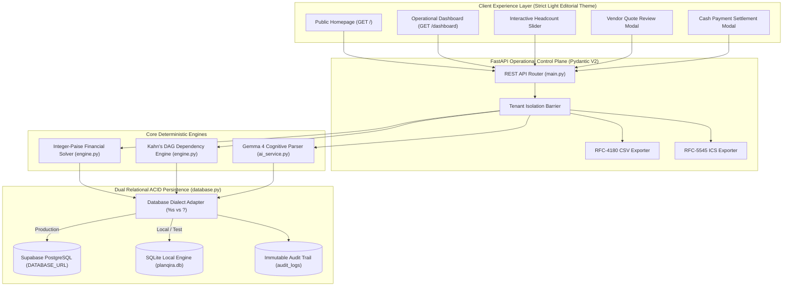
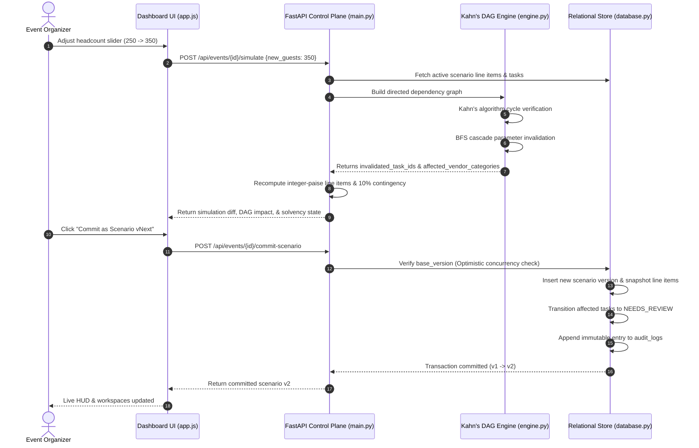
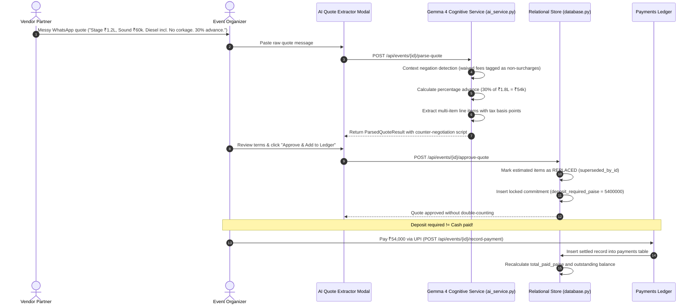
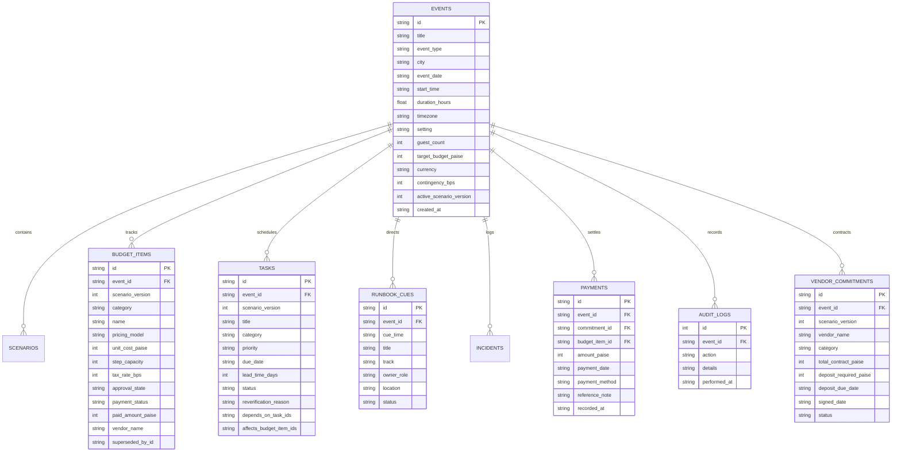
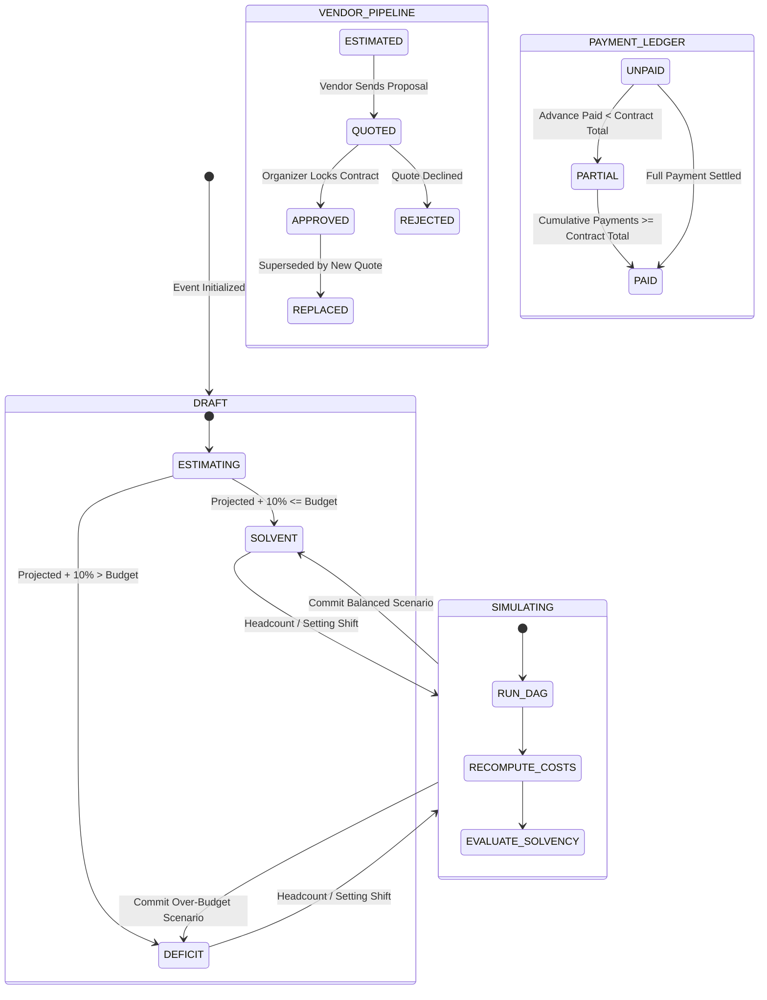

# Planqira — Complete Technical & Architectural Documentation
**Platform:** Planqira • Autonomous Event Decision, Commitment & Operations Platform  
**Target:** Google PromptWars Virtual [Challenge 5] Celebration & Event Planner  
**Repository:** [https://github.com/deveshpunjabi/planqira](https://github.com/deveshpunjabi/planqira)  
**Tagline:** *Every decision. Every detail. Under control.*

---

## Table of Contents

1. [Architectural Overview & System Topology](#1-architectural-overview--system-topology)
2. [System Topology & Data Flow Diagrams](#2-system-topology--data-flow-diagrams)
3. [Deterministic Integer-Paise Financial Math](#3-deterministic-integer-paise-financial-math)
4. [Directed Acyclic Graph (DAG) Invalidation Engine](#4-directed-acyclic-graph-dag-invalidation-engine)
5. [Contract Commitments vs. Cash Flow Ledger Separation](#5-contract-commitments-vs-cash-flow-ledger-separation)
6. [Dual-Mode Relational Persistence (PostgreSQL & SQLite)](#6-dual-mode-relational-persistence-postgresql--sqlite)
7. [Google DeepMind Gemma 4 Cognitive Integration](#7-google-deepmind-gemma-4-cognitive-integration)
8. [Multi-Tenant Isolation & Security Model](#8-multi-tenant-isolation--security-model)
9. [RFC Standards Compliance (CSV & ICS)](#9-rfc-standards-compliance-csv--ics)
10. [REST API Specification](#10-rest-api-specification)
11. [Automated Verification & Test Matrix](#11-automated-verification--test-matrix)

---

## 1. Architectural Overview & System Topology

Planqira was engineered to replace standard text-generation wrappers and naive spreadsheets with a deterministic operations platform. Real-world event planning is fundamentally characterized by **volatility**: guest counts shift unpredictably, vendors submit unstructured and incomplete proposals, weather impacts outdoor venues, and curfews force day-of schedule compressions.

### Core Architectural Tenets
1. **Zero IEEE-754 Precision Drift:** Storing and computing all currency in integer minor units (paise) ensures zero floating-point accumulation errors across thousands of items and scenarios.
2. **Deterministic Solvency Diagnostics:** Eliminates forced 100% budget normalization. If market costs exceed the target budget, Planqira enters an explicit `DEFICIT` state rather than artificially deflating per-guest rates.
3. **Acyclic Operational Dependencies:** Preparation tasks and vendor contracts form a Directed Acyclic Graph (DAG) evaluated using Kahn's algorithm. Core parameter changes cascade invalidation to downstream tasks via Breadth-First Search (BFS).
4. **Decoupled Commitments and Cash Flow:** Contractual approvals (`ESTIMATED` $\rightarrow$ `QUOTED` $\rightarrow$ `APPROVED`) are strictly decoupled from settled cash outlays (`payments` table).
5. **Non-Destructive Forward Versioning:** Scenario revisions and reversions create new forward snapshot revisions, strictly preserving payment ledgers and audit records.
6. **Dual Relational Persistence:** Production deployments connect to managed PostgreSQL (Supabase / Neon / Cloud Run) via `DATABASE_URL` with dynamic dialect translation, while local and testing runs use self-contained SQLite with enforced foreign key integrity.

---

## 2. System Topology & Data Flow Diagrams

### 2.1 Complete System Architecture & Data Flow



---

### 2.2 Scenario Simulation & Topological Invalidation Flow



---

### 2.3 Vendor Quote Parsing, Negation Logic & Ledger Ingestion Flow



---

### 2.4 Entity-Relationship Data Model



---

### 2.5 Solvency Engine State Machine



---

## 3. Deterministic Integer-Paise Financial Math

### 3.1 Eliminating IEEE-754 Floating-Point Drift
Floating-point mathematics in standard computing introduces binary approximation errors (e.g., `0.1 + 0.2 = 0.30000000000000004`). In event budgeting across thousands of items, rounding errors compound, creating ledger discrepancies.

**Planqira Invariant:** All currency is computed, validated, and stored as **integer paise** ($1\text{ INR} = 100\text{ paise}$).

$$\text{Paise} = \text{round}(\text{Rupees} \times 100)$$

### 3.2 Exact Half-Up Tax Rounding
Taxes are specified in integer basis points ($1\text{ bps} = 0.01\%$, $1800\text{ bps} = 18.00\%$). Planqira implements financial half-up rounding using integer floor arithmetic:

$$\text{Tax Paise} = \left\lfloor \frac{\text{Subtotal Paise} \times \text{BPS} + 5000}{10000} \right\rfloor$$

```python
def calculate_tax_paise(subtotal_paise: int, tax_rate_bps: int) -> int:
    if subtotal_paise <= 0 or tax_rate_bps <= 0:
        return 0
    return (subtotal_paise * tax_rate_bps + 5000) // 10000
```

### 3.3 The Three Deterministic Pricing Formulas

| Pricing Model | Formula | Behavior | Real-World Example |
|---|---|---|---|
| `FIXED` | $\text{Unit Cost}$ | Cost remains invariant regardless of guest headcount changes. | Venue rental, candid photographer, DJ audio truss. |
| `PER_CAPITA` | $\text{Unit Cost} \times \text{Guests}$ | Scales directly with each individual attendee. | Banquet buffet plates, welcome gifts, seating chairs. |
| `STEP_TIERED` | $\text{Unit Cost} \times \lceil \frac{\text{Guests}}{\text{Capacity}} \rceil$ | Scales non-linearly in discreet capacity increments. | 50-seater transport coaches, 8-seater dining rounds, dual-sided buffet counters (75 pax capacity). |

```python
def compute_line_item_paise(
    pricing_model: str,
    unit_cost_paise: int,
    guest_count: int,
    step_capacity: int = 1,
    tax_rate_bps: int = 0
) -> Tuple[int, int, int]:
    if pricing_model == "FIXED":
        subtotal = unit_cost_paise
    elif pricing_model == "PER_CAPITA":
        subtotal = unit_cost_paise * max(1, guest_count)
    elif pricing_model == "STEP_TIERED":
        cap = max(1, step_capacity)
        units = (max(1, guest_count) + cap - 1) // cap
        subtotal = unit_cost_paise * units
    tax = calculate_tax_paise(subtotal, tax_rate_bps)
    total = subtotal + tax
    return subtotal, tax, total
```

### 3.4 Solvency Deficit State Detection
Standard event planning software forces budgets to scale to 100% by artificially deflating unit costs. Planqira strictly rejects this practice. If total required spend exceeds the target budget:
1. `contingency_reserve_paise` ($10\%$ of target budget) is explicitly ringfenced.
2. `solvency_status` transitions to `DEFICIT`.
3. `solvency_variance_paise` displays an exact negative shortfall, prompting scope trade-offs in the Scenario Lab.

---

## 4. Directed Acyclic Graph (DAG) Invalidation Engine

### 4.1 Dependency Graph Topology
Operational milestones, vendor selections, and logistics steps form a Directed Acyclic Graph (DAG). An edge $A \rightarrow B$ indicates that task $B$ depends on the completion or parameters of task $A$.

### 4.2 Kahn's Algorithm for Topological Cycle Detection
To prevent deadlocks and circular dependency traps, the DAG engine executes Kahn's algorithm upon initialization and before every simulation commit:

```python
def topological_sort(self) -> List[str]:
    in_degree = {n: 0 for n in self.nodes}
    for u in self.edges:
        for v in self.edges[u]:
            in_degree[v] += 1

    queue = deque([n for n, deg in in_degree.items() if deg == 0])
    ordered = []
    while queue:
        u = queue.popleft()
        ordered.append(u)
        for v in self.edges.get(u, []):
            in_degree[v] -= 1
            if in_degree[v] == 0:
                queue.append(v)

    if len(ordered) != len(self.nodes):
        raise ValueError("Cyclic dependency detected in operational DAG!")
    return ordered
```

### 4.3 Breadth-First Search (BFS) Parameter Invalidation
When core celebration parameters shift (headcount changing by $\ge 15\%$, date shifting, or venue transitioning between outdoor and indoor):
1. Root-level sensitive nodes are flagged (e.g., `task-catering-tasting`, `task-mandap-setup`).
2. A BFS traversal propagates through all downstream dependent tasks.
3. Affected tasks transition to `NEEDS_REVIEW`. If a task was previously marked `DONE`, its status transitions to `NEEDS_REVIEW` with its prior completion status preserved in `reverification_reason`.

---

## 5. Contract Commitments vs. Cash Flow Ledger Separation

A major vulnerability in amateur planning software is equating an approved quote with cash paid. Planqira enforces a strict architectural boundary:

### 5.1 Approval Pipeline vs. Cash Settlement
- **Contractual Status:** `ESTIMATED` $\rightarrow$ `QUOTED` $\rightarrow$ `APPROVED` (or `REJECTED`).
- **Settled Cash Status:** `UNPAID` $\rightarrow$ `PARTIAL` $\rightarrow$ `PAID`.
- **Payment Reconciliation:** `total_paid_paise` is derived dynamically from settled records in the `payments` table. Approving a quote requiring a ₹50,000 deposit does not modify `total_paid_paise`; it updates `deposit_required_paise` on `vendor_commitments`.

### 5.2 Elimination of Double-Counting via `supersedes_item_ids`
When an organizer approves a formal vendor quote for Catering, the pre-existing estimated item in the budget must not remain active alongside the new contract. 
Planqira marks the pre-existing item as `REPLACED` and sets its `superseded_by_id`. Replaced items are excluded from projected spend calculations, ensuring zero double-counting.

### 5.3 Multi-Item Deposit Tracking
When a quote contains multiple line items (e.g., Stage ₹1,20,000 and Sound ₹60,000) with a lump-sum advance (e.g., ₹54,000), Planqira records the deposit obligation strictly on the parent `vendor_commitments` record (`deposit_required_paise = 5400000`). Individual budget items have `deposit_required_paise = 0`, completely preventing deposit multiplication across sub-items.

---

## 6. Dual-Mode Relational Persistence (PostgreSQL & SQLite)

Planqira features an intelligent database abstraction layer supporting both production cloud databases and zero-config local testing environments:

### 6.1 Dynamic Dialect Translation
The persistence adapter automatically checks for `DATABASE_URL` or `POSTGRES_URL`:
- If configured: Connects to managed PostgreSQL (Supabase / Neon), translates query placeholders from SQLite `?` to PostgreSQL `%s`, handles `ON CONFLICT DO NOTHING`, and verifies schema integrity.
- If absent: Connects to local SQLite (`planqira.db`), enforces `PRAGMA foreign_keys = ON;`, and creates tables idempotently.

```python
def is_postgres_configured() -> bool:
    return bool(os.getenv("DATABASE_URL") or os.getenv("POSTGRES_URL"))

def _adapt_query(query: str) -> str:
    if is_postgres_configured():
        return query.replace("?", "%s")
    return query
```

### 6.2 Immutable Scenario Versioning & Safe Forward Revert
1. **Base Version Verification:** Every scenario mutation accepts `base_version`. If another session modified the active version concurrently, the update is rejected with `HTTP 409 Conflict`.
2. **Atomic Version Commits:** Committing a scenario increments `active_scenario_version`, inserts versioned line items, flags invalidated tasks as `NEEDS_REVIEW`, and writes an immutable audit record to `audit_logs`.
3. **Non-Destructive Forward Revert:** Reverting to a prior scenario (e.g., restoring v1 from v2) creates a **new forward revision** (v3) rather than deleting records. Reversion restores line item definitions and parameters with `paid_amount_paise = 0`, dynamically linking cash paid from the `payments` ledger.

---

## 7. Google DeepMind Gemma 4 Cognitive Integration

### 7.1 Structured Pydantic Extraction
Planqira integrates `gemma-4-31b-it` (and `gemma-4-26b-a4b-it`) to parse unstructured vendor proposals into strictly typed Pydantic models:

```python
class ParsedQuoteResult(BaseModel):
    vendor_name: str = Field(..., max_length=120)
    category: str = Field(..., max_length=60)
    extracted_items: List[ExtractedLineItem]
    advance_deposit_paise: int = Field(0, ge=0)
    deposit_due_date: Optional[str] = None
    explicit_clauses_extracted: List[str] = Field(default_factory=list)
    suggested_clarification_questions: List[str] = Field(default_factory=list)
    suggested_negotiation_reply: str = Field("", max_length=1000)
```

### 7.2 Negation & Context Awareness
Quotes often include statements such as *"Diesel included. No corkage fee. Free delivery."* Amateur regex engines detect keywords ("diesel", "corkage") and flag them as hidden fee penalties.
Planqira employs negation context detection:

```python
def _is_negated_or_included(phrase: str, text: str) -> bool:
    patterns = [
        rf"(?:no|without|zero|free|waived|complimentary|nil)\s+(?:\w+\s+){{0,2}}{phrase}",
        rf"{phrase}\s+(?:\w+\s+){{0,2}}(?:included|inclusive|waived|free|covered|complimentary|not\s+applicable)",
    ]
    return any(re.search(p, text, re.IGNORECASE) for p in patterns)
```

### 7.3 Percentage Advance Parsing
When vendors request a percentage advance (e.g., *"40% advance required upon booking"*), Planqira computes the deposit from the total estimated quote:

$$\text{Advance Paise} = \left\lfloor \frac{\text{Total Estimated Quote Paise} \times \text{Percentage}}{100} \right\rfloor$$

This avoids the severe error of treating the numeral `40` as ₹40.

---

## 8. Multi-Tenant Isolation & Security Model

Planqira enforces strict tenant isolation across every data mutation route:
- **Task Mutations (`PATCH /api/events/{id}/tasks/{task_id}`):** Enforces `WHERE id = ? AND event_id = ?`.
- **Runbook Cues (`PATCH /api/events/{id}/runbook/{cue_id}`):** Enforces `WHERE id = ? AND event_id = ?`.
- **Cash Payments (`POST /api/events/{id}/record-payment`):** Verifies that `commitment_id` and `budget_item_id` belong strictly to the requesting `event_id`.
- **Quote Approvals (`POST /api/events/{id}/approve-quote`):** Verifies that all superseded items belong strictly to the target event.
- **CSV Formula Injection Sanitization:** Implements RFC-4180 sanitization by prepending a single quote `'` to any cell beginning with `=`, `+`, `-`, or `@`.

---

## 9. RFC Standards Compliance (CSV & ICS)

### 9.1 RFC-4180 CSV Financial Ledger
- Uses standard comma separation, CRLF line terminators, and double-quote encapsulation.
- Prepends formula triggers (`=`, `+`, `-`, `@`) with `'` to prevent DDE/CSV injection attacks.

### 9.2 RFC-5545 ICS Calendar Protocol
- **Exclusive DTEND:** RFC-5545 specifies that `DTEND` for full-day events is non-inclusive. Planqira correctly offsets multi-day events by $+1$ day.
- **75-Octet Line Folding:** Lines exceeding 75 octets are folded according to RFC-5545 §3.1 (CRLF followed by a single whitespace character).
- **Timezone Awareness:** Formatted with `TZID:Asia/Kolkata` and UTC zero offsets.

---

## 10. REST API Specification

| Method | Endpoint | Description | Request Body | Response Codes |
|---|---|---|---|---|
| `GET` | `/api/health` | Healthcheck and active model status | None | `200 OK` |
| `GET` | `/api/events` | List all registered events | None | `200 OK` |
| `POST` | `/api/events` | Initialize new celebration | `CreateEventRequest` | `201 Created`, `422 Unprocessable` |
| `GET` | `/api/events/{id}` | Full event aggregate & solvency HUD | None | `200 OK`, `404 Not Found` |
| `POST` | `/api/events/{id}/simulate` | Simulate headcount/date/setting shifts | `SimulateRequest` | `200 OK`, `422 Unprocessable` |
| `POST` | `/api/events/{id}/commit-scenario` | Transactionally commit scenario revision | `CommitScenarioRequest` | `200 OK`, `409 Conflict` |
| `POST` | `/api/events/{id}/revert-scenario` | Revert to prior revision via forward commit | `RevertScenarioRequest` | `200 OK`, `400 Bad Request` |
| `POST` | `/api/events/{id}/parse-quote` | AI quote extraction with negation logic | `ParseQuoteRequest` | `200 OK`, `422 Unprocessable` |
| `POST` | `/api/events/{id}/approve-quote` | Approve vendor quote & update ledger | `ApproveQuoteRequest` | `200 OK`, `400 Bad Request` |
| `POST` | `/api/events/{id}/record-payment` | Record actual cash payment outlay | `RecordPaymentRequest` | `200 OK`, `400 Bad Request` |
| `PATCH` | `/api/events/{id}/tasks/{task_id}` | Update task status with tenant isolation | `TaskPatchRequest` | `200 OK`, `404 Not Found` |
| `PATCH` | `/api/events/{id}/runbook/{cue_id}` | Update cue status with tenant isolation | `RunbookPatchRequest` | `200 OK`, `404 Not Found` |
| `GET` | `/api/events/{id}/export.csv` | RFC-4180 financial CSV download | None | `200 OK`, `404 Not Found` |
| `GET` | `/api/events/{id}/export.ics` | RFC-5545 calendar schedule download | None | `200 OK`, `404 Not Found` |

---

## 11. Automated Verification & Test Matrix

Planqira enforces **37 comprehensive automated tests** across backend logic and browser end-to-end interactions:

```bash
# Run backend engine test suite (29 tests)
python -m pytest test_engine.py -v

# Run Playwright browser end-to-end suite (8 tests)
python -m pytest test_e2e_playwright.py -v
```

### Verified Test Summary

| # | Test Identifier | Suite | Domain Tested |
|---|---|---|---|
| 1 | `test_tax_and_contingency_half_up_rounding` | Backend | Exact half-up rounding at arithmetic boundaries |
| 2 | `test_compute_line_item_paise_models` | Backend | FIXED, PER_CAPITA, and STEP_TIERED formulas |
| 3 | `test_compute_line_item_paise_rejections` | Backend | Input validation rejections for negative values |
| 4 | `test_evaluate_solvency_deficit_detection` | Backend | Deficit detection without false price compression |
| 5 | `test_quote_approval_multi_item_and_unique_ids` | Backend | Multi-line approval and UUID generation |
| 6 | `test_quote_approval_separates_deposit_from_payment` | Backend | Contractual deposit separated from cash ledger |
| 7 | `test_record_payment_updates_ledger_and_balances` | Backend | Cash payment settlement updates |
| 8 | `test_quote_replacement_eliminates_double_counting` | Backend | Replacing estimated items with contract quotes |
| 9 | `test_quote_approval_idempotency_retries` | Backend | Safe retry submission handling |
| 10 | `test_stale_scenario_proposal_rejection` | Backend | HTTP 409 conflict on stale base version |
| 11 | `test_scenario_commit_persists_task_and_vendor_invalidation` | Backend | Persistence of NEEDS_REVIEW task flags |
| 12 | `test_scenario_commit_preserves_completed_tasks_and_payments` | Backend | Preserving completed items and ledger |
| 13 | `test_scenario_revert_creates_forward_revision` | Backend | Non-destructive forward-revision restore |
| 14 | `test_create_custom_event` | Backend | Custom celebration creation with foundation items |
| 15 | `test_short_notice_schedule_compression` | Backend | Compressed milestone schedule for lead times < 14 days |
| 16 | `test_incident_logging_and_resolution` | Backend | Operational incident logging and resolution state |
| 17 | `test_ai_model_configuration_and_quote_parsing` | Backend | Configurable Gemma 4 model extraction |
| 18 | `test_ai_quote_parsing_short_input_rejection` | Backend | Rejection of gibberish/short vendor text |
| 19 | `test_csv_export_formula_injection_sanitization` | Backend | RFC-4180 formula injection defense |
| 20 | `test_ics_export_escaping_and_timezone` | Backend | RFC-5545 iCalendar escaping and timestamps |
| 21 | `test_invalid_nested_inputs` | Backend | Pydantic 422 Unprocessable Entity rejections |
| 22 | `test_public_homepage_and_dashboard_routes` | Backend | Verification of `/`, `/dashboard`, and `/api/health` |
| 23 | `test_simulation_endpoint_with_dag_invalidations` | Backend | End-to-end simulation endpoint with DAG cascades |
| 24 | `test_payment_reconciliation_total_paid_paise` | Backend | Total paid paise derived strictly from payments ledger |
| 25 | `test_scenario_revert_preserves_payment_integrity` | Backend | Cash paid preserved during forward revert |
| 26 | `test_cross_event_authorization_isolation` | Backend | Multi-tenant event isolation on all patch/record routes |
| 27 | `test_quote_negation_and_percentage_advance` | Backend | Waived fee logic and 40% advance parsing |
| 28 | `test_rfc5545_exclusive_end_date_and_line_folding` | Backend | RFC-5545 75-octet folding and exclusive DTEND |
| 29 | `test_event_dietary_and_aesthetic_personalization` | Backend | Jain/Halal/Vegan dietary line-item shaping |
| 30 | `test_homepage_render` | Playwright E2E | Editorial typography, 10% contingency calculator, and CTA |
| 31 | `test_dashboard_workspaces_and_navigation` | Playwright E2E | Persistent 235px sidebar navigation across all 6 workspaces |
| 32 | `test_quote_extraction_modal` | Playwright E2E | Multi-item extraction, percentage advance, and waived fees |
| 33 | `test_record_payment_modal` | Playwright E2E | Cash payment recording, ledger posting, and HUD balance update |
| 34 | `test_scenario_lab_simulation` | Playwright E2E | Headcount slider, real-time diff calculation, and DAG alert |
| 35 | `test_accessibility_keyboard_modal_dismissal` | Playwright E2E | Escape key modal dismiss listener and focus retention |
| 36 | `test_file_exports_csv_and_ics` | Playwright E2E | RFC-4180 CSV and RFC-5545 ICS download endpoints |
| 37 | `test_light_editorial_theme_styling` | Playwright E2E | Strict Light Theme verification (zero dark mode, warm ivory palette) |
