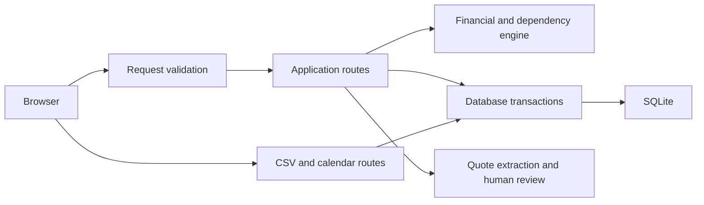

# Planqira architecture

This document describes the implemented application. Setup and release limits live in README.md; verification evidence lives in TEST-REPORT.md.

## Module boundaries

| Module | Responsibility |
|---|---|
| main.py | Application lifecycle, middleware, event routes, HTTP error mapping, static pages |
| schemas.py | Request validation: event details, quotes, payments, changes, task updates |
| exports.py | CSV and calendar routes, safe escaping, timezone conversion, Unicode line folding |
| engine.py | Pure integer-paise pricing, solvency calculations, dependency traversal, scenario comparison |
| database_setup.py | SQLite connection lifetime, table creation, additive migrations, indexes |
| seed_data.py | Three fictional examples inserted only into an empty database |
| event_creation.py | Atomic creation of an event, initial estimates, tasks, schedule, and themes |
| database.py | Event reads, scenario transactions, quote approvals, payments, operational updates |
| ai_service.py | Optional model-based quote extraction with a disclosed basic-parser fallback |
| static/ | Homepage, light dashboard, browser interactions, and styles |
| api/index.py | Vercel entry point importing the same application |

Modules depend on the financial engine and storage setup, not on the application instance. Export routes are registered with an APIRouter. Existing database.create_event, database.init_db, and connection helpers remain available through explicit re-exports.

## Request flow

Quote extraction proposes terms; approving a quote creates an obligation. Recording a payment creates cash history. A preview computes proposed consequences without changing saved state. Saving or restoring a scenario creates a new version.

## Financial invariants

- Monetary calculations use integer paise; taxes use half-up rounding.
- Fixed items have quantity one, per-person items follow headcount, and tiered items use exact integer ceiling division.
- An explicit inclusive-tax flag preserves the quoted gross price through saving and version copies.
- The reserve is computed from the target budget. An unaffordable plan remains a deficit.
- Approval does not record payment. Cash comes from payment records.
- Outstanding amounts sum each active item's unpaid balance. Unassigned cash and overpayments on another item cannot settle that balance. Vendor-only payments remain cash history until linked to a budget item.
- Newly copied items retain an obligation identity. Copies reset cached paid values; the payment ledger remains authoritative.
- Retried operations use explicit keys. Conflicting payloads are rejected; separate payment operations may have identical amounts.

## Storage and migrations

Connections commit or roll back and close on context exit. Migrations inspect existing columns before issuing ALTER TABLE; unexpected migration failures are not silently swallowed. Indexes support event-scoped reads, ordered tasks, payment history, and recent audit records.

Scenario commit and restore share one budget-item copying function. Copies preserve pricing, approval state, tax treatment, and obligation identity. Version checks reject stale scenario proposals. Preview and commit use the same task-dependency builder.

Restore retains current approved contracts and replaced estimates while restoring planning assumptions; it never cancels contracts or deletes payments. Event-date changes shift checklist deadlines by the same day offset, preserving task identities, and flag affected work for review. Past-due shifted tasks remain visible for review rather than being silently completed. New events require today or a future date in their configured timezone.

SQLite is durable only when its file is kept on durable storage. Vercel uses temporary storage in this implementation. There is no PostgreSQL adapter, authentication system, or user-ownership enforcement. Historical metadata that was never stored cannot be reconstructed by a migration.

## Export and browser behavior

CSV output escapes user-controlled formula triggers. Calendar output uses UTC for timed entries, exclusive end dates for all-day tasks, escaped text, and UTF-8-safe folding at 75 octets. Folding processes each character once.

The dashboard preserves active navigation, offers load/retry states, uses keyboard-accessible modal behavior, and respects reduced-motion preferences. A failed payment request retains its operation key for retry. Quote review allows correcting rates and choosing estimates to replace.

## Quality checks

One pyproject.toml defines Python formatting and lint rules. CI runs both checks before backend and Chromium tests. The checks cover imports, unused variables, common Python errors, exception chaining, and selected correctness rules; they are not a comprehensive security audit.

Run the commands in README.md before changing these boundaries. Use a temporary database for tests. Never reset the working database as a shortcut to making a migration pass.

## Remaining limits

The homepage calculator is illustrative. Quote terms beyond unit price do not yet have a complete editing workflow. Date shifts preserve relative deadlines; they do not infer vendor availability or optimize a new schedule. Live model compatibility, production durability, authorization, load behavior, and a full assistive-technology audit remain separate release checks.
